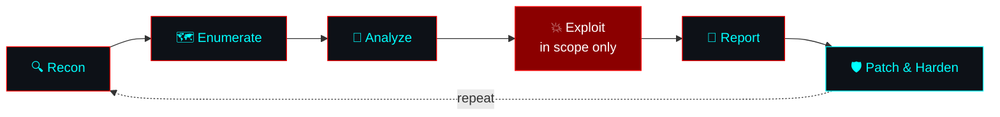

<div align="center">

<!-- ANIMATED HEADER -->


<!-- TYPING ANIMATION (self-hosted: assets/typing.svg) -->


<!-- STATUS BADGES -->


<br/>


</div>

---

## 🔴 [ IDENTITY MATRIX: CLASSIFIED LEVEL Ω ]

```bash
┌──(cosmichackerx㉿kali)-[~]
└─$ sudo whoami --verbose
[*] Initiating deep identity protocol...
[*] Decrypting persona matrix...
[+] Access granted.

┏━━━━━━━━━━━━━━━━━━━━━━━━━━━━━━━━━━━━━━━━━━━━━━━━━━━━━━━━┓
┃  ⚠️  SECURITY CLEARANCE: LEVEL OMEGA                    ┃
┣━━━━━━━━━━━━━━━━━━━━━━━━━━━━━━━━━━━━━━━━━━━━━━━━━━━━━━━━┫
┃ 👤 OPERATOR      : Muhammad Arslan  (aka CosmicHackerX)  ┃
┃ 🎓 TRAINING      : BSCS @ FUUAST, Islamabad              ┃
┃ 📍 BASE          : Islamabad, Pakistan  (UTC+5)          ┃
┃ 💀 DESIGNATION   : Bug Bounty Hunter | CTF Player        ┃
┃ 📱 SIDE QUEST    : Android Dev | AI Tools | Automation   ┃
┃ ⚡ DIRECTIVE     : Dismantle. Analyze. Rebuild. Harden.  ┃
┃ 🎯 HUNTING GROUND: HackerOne · Bugcrowd · CTFtime        ┃
┃ 🌍 OFF-DUTY      : Travel · Cultures · Languages         ┃
┗━━━━━━━━━━━━━━━━━━━━━━━━━━━━━━━━━━━━━━━━━━━━━━━━━━━━━━━━┛

[✓] Encryption protocols : ACTIVE
[✓] Recon modules        : LOADED
[✓] Scope check          : ALWAYS FIRST
[✓] Attack vectors       : ARMED (authorized targets only)
```

<div align="center">

### ⚡ **I don't just break things. I learn how they work — then make them stronger.**

*Breaker of assumptions. Reader of source code. Writer of reports that get triaged.*


</div>

---

## 🎯 [ ACTIVE OPERATIONS: CLASSIFIED DOSSIER ]

<div align="center">

```diff
@@@ OPERATION STATUS BOARD @@@

+ [ACTIVE] Hunting vulnerabilities on public bug bounty programs
+ [ACTIVE] Grinding CTFs: web, crypto, reversing, forensics
+ [ACTIVE] Building Android apps in Kotlin
+ [ACTIVE] Shipping AI-powered tools & automations
+ [ACTIVE] BSCS coursework: ADBMS, Information Security & more

! [ALERT] Coffee reserves critically low
! [ALERT] Unread recon output: 4,096 lines
! [ALERT] Another rabbit hole detected in sector 7-G

- [DISABLED] Sleep function (permanently offline)
- [DISABLED] Fear subroutine (deleted)
- [DISABLED] Testing out of scope (never compiled)

# [HARDCODED] Ethical boundaries: non-negotiable
# [CLASSIFIED] Project Nemesis: Deployment imminent
```

</div>

---

## 🧭 [ ATTACK METHODOLOGY: KILL CHAIN ]



---

## 💀 [ WEAPONIZED ARSENAL: TECH STACK ]

<div align="center">

### ⚔️ Primary Weapons: Languages


### 🛡️ Frameworks & Platforms


### 🔧 Infrastructure


### 🎯 Specialized Attack Vectors


### 🤖 AI Arsenal


</div>

---

## 📊 [ SYSTEM DIAGNOSTICS: PERFORMANCE METRICS ]

<div align="center">

<!-- Generated by .github/workflows/profile-assets.yml -->





<br/>


</div>

---

## 🎮 [ CLASSIFIED PROJECTS: LEVEL Ω CLEARANCE REQUIRED ]

<div align="center">

```ascii
╔═══════════════════════════════════════════════════════════════╗
║                  ⚠️  TOP SECRET OPERATIONS  ⚠️                ║
╠═══════════════════════════════════════════════════════════════╣
║                                                               ║
║  🧠 PROJECT NEXUS: AI-Assisted Recon Toolkit                  ║
║     └─ Automated subdomain & asset discovery                  ║
║     └─ LLM-powered triage of scan output                      ║
║     └─ Report drafting for bug bounty findings                ║
║                                                               ║
║  📱 PROJECT ANDROMEDA: Android App Lab                        ║
║     └─ Kotlin + Jetpack Compose builds                        ║
║     └─ Mobile app security testing (OWASP MASVS)              ║
║                                                               ║
║  🏎️  PROJECT VELOCITY: 3D Browser Racing Game                 ║
║     └─ Mobile-first, runs in the browser                      ║
║     └─ Built with AI coding agents                            ║
║                                                               ║
║  🚩 PROJECT FLAGSTORM: CTF Writeups & Tooling                 ║
║     └─ Web · Crypto · Reversing · Forensics                   ║
║                                                               ║
║  🔥 PROJECT NEMESIS: [REDACTED]                               ║
║     └─ ████████████████████████                               ║
║                                                               ║
╚═══════════════════════════════════════════════════════════════╝
```

</div>

---

## 🏆 [ ACHIEVEMENTS MATRIX ]

<div align="center">


### 📚 Standards & Frameworks I Work With


### 🚩 Hunting Grounds


</div>

---

## 🎯 [ SKILL MATRIX: COMPETENCY BREAKDOWN ]

<div align="center">

```yaml
Offensive Security:
  Web App Pentesting   : ████████████████░░░░  80%
  Recon & OSINT        : █████████████████░░░  85%
  Mobile App Security  : ██████████████░░░░░░  70%
  Reverse Engineering  : ███████████░░░░░░░░░  55%   # leveling up

Defensive Security:
  Secure Code Review   : ██████████████░░░░░░  70%
  Threat Modeling      : ████████████░░░░░░░░  60%
  Incident Response    : ██████████░░░░░░░░░░  50%   # leveling up

Development:
  Python & Automation  : ██████████████████░░  90%
  Android (Kotlin)     : ████████████████░░░░  80%
  Full Stack (TS/JS)   : ███████████████░░░░░  75%
  AI/LLM Integration   : █████████████████░░░  85%

Current XP Target: Exploit dev · Cloud security · CVE #1
```

</div>

---

## 🔥 [ REAL-TIME ACTIVITY FEED ]

<div align="center">

### 📡 Recent Breaches & Contributions

</div>

<!--START_SECTION:activity-->
1. 🚀 Published release [v0.2.1 — No WhatsApp shutdown/restart](https://github.com/cosmichackerx/cosmic-wa-bot/releases/tag/v0.2.1) in [cosmichackerx/cosmic-wa-bot](https://github.com/cosmichackerx/cosmic-wa-bot)
<!--END_SECTION:activity-->

---

## 💻 [ HACKER MANIFESTO: CORE PHILOSOPHY ]

```python
#!/usr/bin/env python3
"""COSMIC HACKER X — operational philosophy. Clearance: OMEGA."""

class CosmicHackerX:
    def __init__(self):
        self.name     = "Muhammad Arslan"
        self.base     = "Islamabad, PK"
        self.mindset  = "Dismantle. Analyze. Rebuild. Harden."
        self.rules    = ["Read the scope", "Never touch prod data", "Report responsibly"]
        self.learning = ["Exploit development", "Cloud security", "Malware analysis"]

    def operational_loop(self):
        while True:
            target = self.pick_program(in_scope=True)
            findings = self.recon(target) >> self.analyze() >> self.verify()
            self.report(findings, responsibly=True)
            self.learn_from(findings)

    def core_principles(self):
        return {
            "curiosity":   "Question everything. Assume nothing.",
            "persistence": "Failure is data. Duplicates are lessons.",
            "integrity":   "Power demands responsibility. Ethics are non-negotiable.",
            "craft":       "A great report is worth more than a great exploit.",
        }

    def motto(self):
        return ("Every system has an entry point.\n"
                "My job is to find it before someone worse does.")

if __name__ == "__main__":
    print(CosmicHackerX().motto())
```

---

## 🌐 [ SECURE COMMUNICATION CHANNELS ]

<div align="center">

[](https://cosmichackerx.lovable.app)
[](https://github.com/cosmichackerx)
[](https://github.com/CosmicArmyX)
<!-- TODO: replace each URL below with your own profile link, or delete the line -->
[](https://linkedin.com/in/YOUR-HANDLE)
[](https://hackerone.com/YOUR-HANDLE)
[](https://x.com/YOUR-HANDLE)


</div>

---

<div align="center">

### ⚡ **"I don't hack systems. I negotiate with them. They always comply."**

```bash
> system.status
STATUS: ONLINE | MODE: WHITE HAT | SCOPE: VERIFIED
> threat.level
CRITICAL — to bugs only
> mission.objective
FIND IT · PROVE IT · REPORT IT · FIX IT
```

### 💀 **CLASSIFIED AXIOM** 💀

**"Every system has an entry point.**  
**Every protocol has an exception.**  
**Every firewall has a blind spot.**  
**I find them first — and I write the report."**


**© 2026 CosmicHackerX** · *Encrypted. Curious. Inevitable.*


</div>
